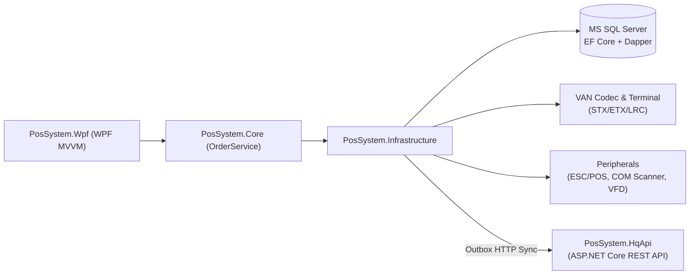

# POS SYSTEM Solution (C# / .NET 8 / WPF / MSSQL / ASP.NET Core)

유통·외식 POS 및 결제 시스템 개발 직무(C#/.NET, WPF, MSSQL, VAN/PG 결제, 주변기기, 본사-가맹점 API 연동)에 맞춰 설계·구현한 **Visual Studio 2022 포트폴리오 솔루션**입니다.

---

## 1. 채용공고 요구사항 매핑

| 구분 | 채용공고 요구사항 / 우대사항 | 본 프로젝트 구현 내용 |
| :--- | :--- | :--- |
| **언어 / 프레임워크** | C# 및 .NET (.NET 6 이상), WPF MVVM | `.NET 8.0` 기반, `CommunityToolkit.Mvvm` + `Microsoft.Extensions.DependencyInjection` |
| **데이터베이스 / ORM** | MSSQL 활용, Entity Framework / Dapper | **MS SQL Server** 기반 `EF Core 8`(트랜잭션/엔티티) + **Dapper**(일일 매출/정산 고성능 집계 SQL) 병행 |
| **결제 연동 / VAN 전문** | VAN/PG, 카드단말기, 간편결제, 현금영수증, 전문 이해 | `VanPacketCodec` (`STX/LEN/FS/ETX/LRC` 체크섬 프레임 인코딩·디코딩) + `MockVanTerminalClient` (99,999원 거절 시뮬레이션 포함) |
| **주변기기 연동** | 영수증 프린터, 바코드 스캐너, 캐시드로어, 고객용 디스플레이 | `EscPosReceiptPrinter` (`ESC @`, `GS V` 커맨드 & COM 포트/시뮬레이터), `SerialBarcodeScanner` (`System.IO.Ports`), `SimulatedCashDrawer`, `SimulatedCustomerDisplay` (2x20 VFD) |
| **매장 업무 로직** | 주문/매출/재고/정산 | 장바구니, 한국 부가세(1/11) 자동 산출, 결제/취소(원거래 취소 + 재고 복원), 일일 정산 마감 및 시재 차액 계산 |
| **본사-가맹점 연동** | ASP.NET Core / REST API, 데이터 동기화 | **Transactional Outbox 패턴** + `PosSystem.HqApi` (멱등성 보장 이벤트 수신 및 상품 마스터 배포) |
| **장애 대응 / 문서화** | 현장 장애 대응, 협업 및 문서화 | `DiagnosticLogs` 테이블/실시간 모니터, [VAN 전문 정의서](docs/VAN_PROTOCOL_SPEC.md), [현장 장애 대응 매뉴얼](docs/TROUBLESHOOTING_GUIDE.md) |

---

## 2. 솔루션 구조 (`PosSystem.sln`)

```text
PosSystem.sln
├── src/
│   ├── PosSystem.Core/            # 도메인 모델, 비즈니스 서비스(OrderService), 인터페이스
│   ├── PosSystem.Infrastructure/  # MSSQL(EF Core + Dapper), VAN 전문 코덱, ESC/POS, COM 시리얼, HQ Sync
│   ├── PosSystem.HqApi/           # ASP.NET Core Web API (본사 서버: 상품 배포, 멱등성 Outbox 수신)
│   └── PosSystem.Wpf/             # WPF 데스크톱 POS UI (MVVM 5개 탭 화면)
├── tests/
│   └── PosSystem.Tests/           # xUnit 단위 테스트 (VAN LRC, 부가세, ESC/POS, 주문/취소)
└── docs/
    ├── VAN_PROTOCOL_SPEC.md          # VAN 결제 전문 규격서
    └── TROUBLESHOOTING_GUIDE.md      # 고객사 현장 장애 대응 매뉴얼
```



---

## 3. 실행 방법

### 사전 요구사항
- **Visual Studio 2022** (v17.8 이상, `.NET 데스크톱 개발` 및 `ASP.NET 및 웹 개발` 워크로드)
- **Microsoft SQL Server** (`src/PosSystem.Wpf/appsettings.json`의 `ConnectionStrings:PosDb`에서 서버/인증 정보 설정 가능, 기본값 `Server=localhost;Database=PosSystemDb;Trusted_Connection=True;TrustServerCertificate=True`)

### Visual Studio 2022에서 실행
1. `PosSystem.sln`을 엽니다.
2. 솔루션 속성 → **여러 시작 프로젝트(Multiple startup projects)**에서 다음 두 프로젝트를 `시작`으로 설정합니다:
   - `PosSystem.HqApi`
   - `PosSystem.Wpf`
3. `F5`를 눌러 실행합니다. 최초 실행 시 `PosSystemDb`가 자동 생성되며 기본 상품 12종이 시드됩니다.

### CLI에서 실행 및 테스트
```powershell
# 솔루션 전체 빌드 및 단위 테스트 실행
dotnet build PosSystem.sln
dotnet test PosSystem.sln

# (터미널 1) 본사 API 서버 실행 (http://localhost:5180/swagger)
dotnet run --project src/PosSystem.HqApi

# (터미널 2) WPF POS 실행
dotnet run --project src/PosSystem.Wpf
```
